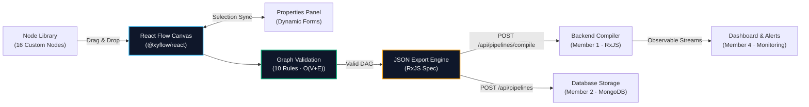

# NexusFlow
### Visual IoT Telemetry & Dynamic Rule Engine
**Member 3 – React & React Flow Visual Graph Builder**

---

NexusFlow is an enterprise-grade visual pipeline builder designed for Industrial IoT (IIoT) mission-critical environments. It enables plant operators, automation engineers, and SCADA administrators to construct complex real-time telemetry processing workflows using an intuitive drag-and-drop interface, configure dynamic rules, enforce topological invariants client-side, and serialize execution definitions into standardized JSON specifications for backend streaming compilers.

---

## 📌 Problem Statement

Industrial IoT infrastructures—such as power generation turbines, chemical processing plants, and water treatment facilities—generate continuous high-velocity telemetry streams (temperature, pressure, vibration, rotational velocity). 

Traditionally, updating stream filtering logic, anomaly detection thresholds, or emergency interlocks required:
1. **Manual Backend Re-compilation:** Writing custom code and redeploying microservices for minor threshold adjustments.
2. **Elevated Risk of Pipeline Defects:** High potential for deployment bugs, such as unhandled null references, circular dependency loops, or orphaned stream sinks.
3. **Lack of Operational Visibility:** Field operators and domain specialists without software engineering backgrounds lacked a visual medium to inspect, understand, and safely modify live telemetry workflows.

**NexusFlow** eliminates this bottleneck by introducing a zero-code visual Directed Acyclic Graph (DAG) studio, providing immediate client-side validation, live property configuration, and deterministic handoff to backend stream processing engines.

---

## 🎯 Objectives

- **Interactive Visual Canvas:** Deliver a smooth, hardware-accelerated 60 FPS graph workspace with pan, zoom, fit-view, and connection management.
- **Comprehensive IIoT Component Suite:** Provide 16 purpose-built, configurable nodes spanning Data Sources, Stream Processing, Logical Conditions, and Alert Actions.
- **Robust Connection & State Handling:** Support dynamic port snapping, directional flow arrows, duplicate ID prevention, and isolated node mutations.
- **Client-Side Topological Validation:** Intercept structural flaws (cycles, disconnected components, missing roots) prior to backend submission.
- **Standardized JSON Serialization:** Export complete pipeline specifications matching the schema requirements of Member 1's RxJS stream compiler.
- **Production Integration Layer:** Provide a resilient HTTP service abstraction supporting submission, caching, loading states, and offline fallback simulation.

---

## 👤 Member 3 Responsibilities

As **Member 3**, development is strictly focused on the **Frontend Visual Graph Builder**:

- **Included Scope:**
  - Visual DAG graph canvas using `@xyflow/react`.
  - Draggable Node Library organized into 4 expandable categories with instant search filtering.
  - Dynamic Node Properties Panel with real-time bidirectional parameter editing.
  - Algorithmic graph validation engine enforcing 10 topological rules.
  - JSON serialization with in-app modal inspection, clipboard copy, and file download.
  - Frontend integration layer (`pipelineApi.js`) interfacing with backend APIs.


---

## 🏛️ Architecture



---

## 🛠️ Technology Stack

- **Core Framework:** React 18+ (JavaScript / JSX)
- **Bundler & Tooling:** Vite 6 (Fast HMR, optimized production chunks)
- **Graphing Engine:** `@xyflow/react` (React Flow 12 — virtualized SVG/HTML canvas)
- **Routing:** `react-router-dom v6` (Multi-view navigation: Studio, Saved Pipelines, Templates)
- **Iconography:** `lucide-react` (Industrial-grade vector icons)
- **Styling Architecture:** Pure Modular CSS (`variables.css` + component-specific stylesheets, zero runtime CSS-in-JS overhead)

---

## 🧩 Node Catalog

The builder includes 16 specialized industrial components categorized by operational role:

| Category | Node | Description | Default Port Configuration |
| :--- | :--- | :--- | :--- |
| **Data Sources** | Turbine Sensor | Rotational telemetry (RPM, rotor torque, power output) | Output (Right) |
| **Data Sources** | Temperature Sensor | Thermal sensors measuring core, bearing, and ambient values | Output (Right) |
| **Data Sources** | Pressure Sensor | Hydraulic and pneumatic pressure monitoring | Output (Right) |
| **Data Sources** | Vibration Sensor | Multi-axis accelerometer telemetry for early fault detection | Output (Right) |
| **Processing** | Moving Average | Smooths noisy sensor feeds over a rolling sample window | Input (Left) & Output (Right) |
| **Processing** | Min / Max Tracker | Tracks rolling minimum or maximum values within time slices | Input (Left) & Output (Right) |
| **Processing** | Math Operation | Scalar arithmetic (`+`, `-`, `*`, `/`) applied to metrics | Input (Left) & Output (Right) |
| **Processing** | Filter | Evaluates telemetry attributes against pass/fail criteria | Input (Left) & Output (Right) |
| **Conditions** | Threshold | Evaluates if telemetry exceeds safety limits with operator choices | Input (Left) & Output (Right) |
| **Conditions** | Greater Than | Simple high-limit comparator for safety interlocks | Input (Left) & Output (Right) |
| **Conditions** | Less Than | Low-limit comparator (e.g., pressure loss or fuel starvation) | Input (Left) & Output (Right) |
| **Conditions** | AND / OR Gate | Combines multiple condition streams into composite boolean logic | Input (Left) & Output (Right) |
| **Actions** | SMS Alert | Triggers urgent text dispatch to on-call field technicians | Input (Left) |
| **Actions** | Email Alert | Formats detailed diagnostic reports to engineering teams | Input (Left) |
| **Actions** | Webhook | Dispatches structured HTTP payloads to external SCADA or ERP systems | Input (Left) |
| **Actions** | Log Event | Records audit events to central observability collectors | Input (Left) |

---

## 📂 Project Structure

```text
NexusFlow/
├── README.md                      # Engineering documentation & viva defense guide
└── frontend/                      # Complete React frontend application
    ├── public/                    # Static public assets
    ├── src/
    │   ├── components/
    │   │   ├── canvas/            # Canvas viewport, empty-state, toolbar
    │   │   ├── common/            # Reusable buttons, badges, modals
    │   │   ├── layout/            # Top navigation bar, collapsible sidebars
    │   │   ├── nodeLibrary/       # Accordion node palette and search
    │   │   ├── nodes/             # 16 custom node components & registry
    │   │   ├── properties/        # Dynamic form inspectors by category
    │   │   └── validation/        # Topological error & warning drawer
    │   ├── pages/                 # BuilderPage, PipelinesPage, TemplatesPage
    │   ├── services/              # pipelineApi.js (backend integration layer)
    │   ├── styles/                # variables.css (design tokens) and global.css
    │   ├── utils/                 # graphValidator.js, jsonSerializer.js, nodeCatalog.js
    │   ├── App.jsx                # Router mount & global state shell
    │   └── main.jsx               # Application entry point
    ├── index.html                 # HTML5 container with industrial typography
    ├── package.json               # Dependencies & scripts
    └── vite.config.js             # Vite configuration
```

---

## ⚡ Installation & Run

### Prerequisites
- Node.js 18+ installed
- Git CLI

### Local Development Setup
```bash
# 1. Clone repository
git clone https://github.com/Aishwaryabhavaraju/NexusFlow.git

# 2. Navigate into the frontend workspace
cd NexusFlow/frontend

# 3. Install dependencies
npm install

# 4. Start Vite development server
npm run dev
```

Open the local URL displayed in the terminal (typically **`http://localhost:3000`** or **`http://localhost:5173`**).

### Production Build
```bash
# Build optimized production bundle
npm run build

# Preview production build locally
npm run preview
```

---

## 🔍 Pipeline Validation Engine

Before any pipeline is permitted to execute or save, the client-side validation engine (`frontend/src/utils/graphValidator.js`) evaluates the graph against **10 strict topological and configuration rules**:

1. **Non-Empty Pipeline:** The pipeline must contain at least one node.
2. **Mandatory Configuration:** All required node parameters (e.g., Sensor ID, threshold value, target recipient) must be filled.
3. **Data Source Origin:** The pipeline must begin with at least one Data Source node (`inDegree === 0`).
4. **Intermediate Invariant:** Processing and Condition nodes require valid incoming connections (`inDegree >= 1`).
5. **Action Invariant:** Action nodes require at least one incoming connection (`inDegree >= 1`) and cannot act as source emitters.
6. **Cycle Detection (Acyclicity):** Graph must be a valid Directed Acyclic Graph (DAG). Cycles are detected using **Kahn's Topological Sorting Algorithm** with $\mathcal{O}(V + E)$ time complexity.
7. **Self-Connection Prevention:** Nodes cannot connect directly to themselves (`source === target` rejected).
8. **Disconnection Identification:** Unconnected or orphan nodes are flagged with visual warnings.
9. **Port Compatibility:** Connection handles must adhere to compatible directional semantic types.
10. **Execution Safety Guard:** The "Run Pipeline" and "Save" triggers are disabled while validation errors exist.

---

## 📊 JSON Export Specification

The serialized JSON structure is formatted specifically for handoff to **Member 1's backend RxJS compiler**:

```json
{
  "pipelineId": "pipe_turbine_alpha_01",
  "name": "Turbine Overheat Detection & Safety Interlock",
  "version": "1.0.0",
  "createdAt": "2026-11-28T18:00:00.000Z",
  "nodes": [
    {
      "id": "node_source_1",
      "type": "turbineSensor",
      "category": "dataSource",
      "position": { "x": 100, "y": 200 },
      "data": {
        "label": "Turbine Sensor",
        "sensorId": "TURBINE-UNIT-4B",
        "samplingRateMs": 1000,
        "metric": "temperature"
      }
    },
    {
      "id": "node_proc_1",
      "type": "movingAverage",
      "category": "processing",
      "position": { "x": 420, "y": 200 },
      "data": {
        "label": "Moving Average",
        "windowSize": 10,
        "inputField": "temperature",
        "outputField": "avg_temperature"
      }
    },
    {
      "id": "node_cond_1",
      "type": "threshold",
      "category": "condition",
      "position": { "x": 740, "y": 200 },
      "data": {
        "label": "Threshold",
        "operator": ">",
        "thresholdValue": 85.0,
        "unit": "°C"
      }
    },
    {
      "id": "node_action_1",
      "type": "smsAlert",
      "category": "action",
      "position": { "x": 1060, "y": 200 },
      "data": {
        "label": "SMS Alert",
        "phoneNumber": "+1-555-0199",
        "message": "Critical Alert: Turbine 4B Temperature exceeds 85°C!"
      }
    }
  ],
  "edges": [
    {
      "id": "e_source_to_proc",
      "source": "node_source_1",
      "target": "node_proc_1"
    },
    {
      "id": "e_proc_to_cond",
      "source": "node_proc_1",
      "target": "node_cond_1"
    },
    {
      "id": "e_cond_to_action",
      "source": "node_cond_1",
      "target": "node_action_1"
    }
  ]
}
```
---

## 📈 GitHub Contribution & Submission Compliance

- **Branch Hygiene:** All work strictly maintained on branch **`member3-frontend-graph`**.
- **Meaningful Commits:** Every milestone commit includes production code or technical documentation exceeding **50+ changed characters**.
- **Day Distribution:** Work is tracked across distinct calendar days during Weeks 1–2 in adherence to academic and evaluation criteria.
- **Clear Commit Messages:** Uses standard conventional commit prefixes (`feat:`, `fix:`, `docs:`, `refactor:`, `test:`).

---

## 🚀 Future Enhancements

- **Industry Topology Templates:** One-click pre-configured pipelines for wind turbines, oil compressors, and water stations.
- **Persistent Pipeline Manager:** Load, clone, and manage historical pipeline revisions from Member 2 database.
- **Undo / Redo History Stack:** State snapshot history for rapid workflow recovery.
- **Dagre Auto-Layout:** Automatic algorithmic graph layout alignment for large multi-branch pipelines.
- **JSON Import & Reverse Deserialization:** Upload external JSON files to automatically reconstruct the visual DAG.
- **Live Stream Preview:** Real-time visual pulse animations on edges indicating live message throughput.

---

**NexusFlow Member 3: Visual Pipeline Builder · React · React Flow · Validation · JSON Export**
